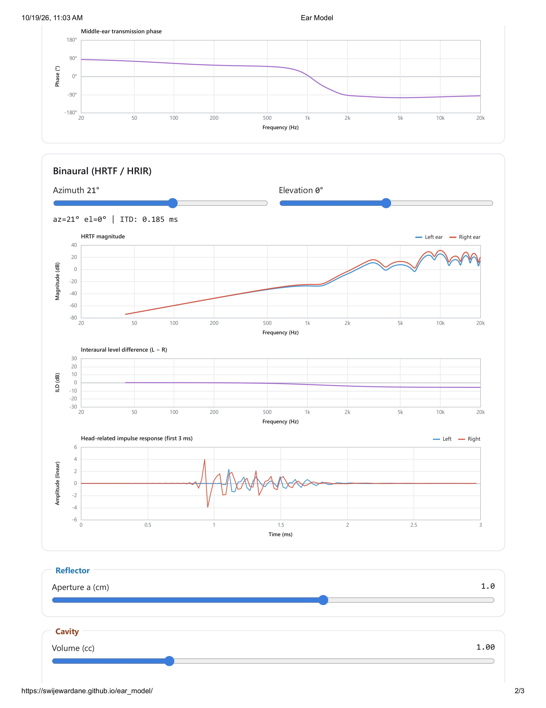
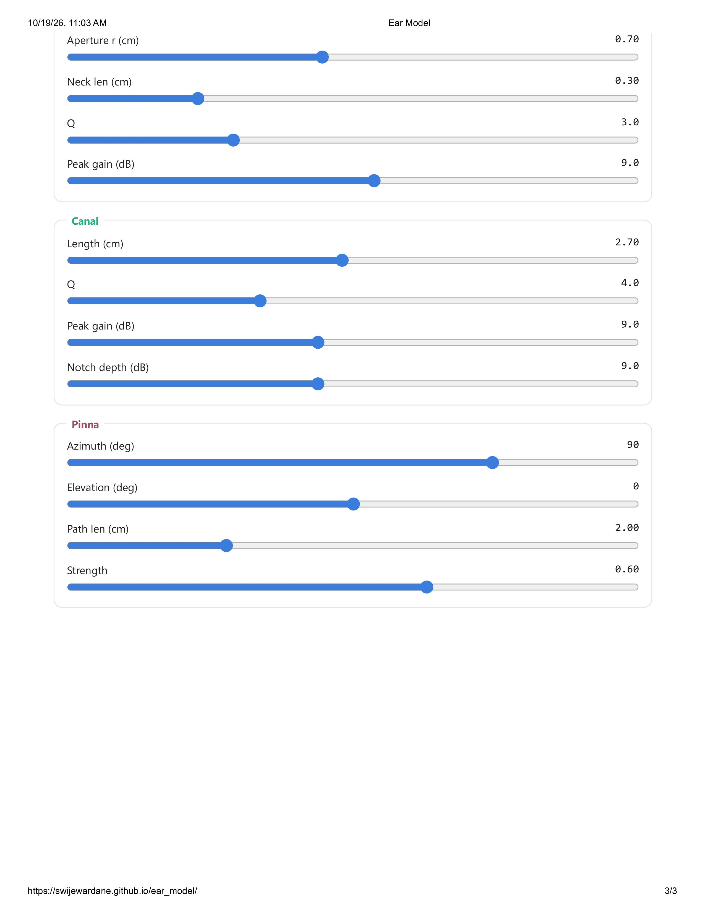

  
  
  

This project houses an interactive, real-time auditory simulation of outer and middle ear mechanics using JavaScript, Web Audio API, and HTML5 Canvas, integrating physical resonator models with complex frequency-domain lumped-element circuit solvers. Binaural spatialization processing incorporating interaural time and level differences (ITD/ILD) alongside IFFT-synthesized head-related impulse responses (HRIRs) are also presently separately. A dynamic FIR filter design pipeline using radix-2 FFT is used to map the 16 interactive parameters to a 1024-tap convolution engine for low-latency, real-time audio processing.
